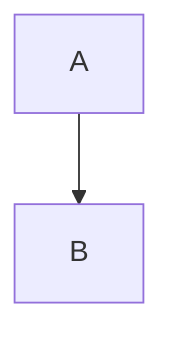

# GFM sample

## Emphasis & links

**bold** *italic* ~~strike~~ `code :tada:` :tada: :not_an_emoji: www.example.com https://example.com/a?b=1. me@example.com
H<sub>2</sub>O x<sup>2</sup> <kbd>Ctrl</kbd>

## Lists

- [ ] todo
- [x] done

1. one
2. two

## Table

| Left | Centre | Right |
| :--- | :----: | ----: |
| a | b | c |

## Alerts

> [!NOTE]
> A note with *emphasis*.

> [!caution]
>
> Lower-case marker, body in its own paragraph.

> [!WARNING] not alone on its line
> stays a blockquote

> A plain quote.

## Footnotes

Text[^1] and more[^note].

[^1]: First.
[^note]: Second.

## Details

<details>
<summary>More</summary>

Inner **markdown**.

</details>

## Math

Inline $a^2 + b^2 = c^2$.

$$
\int_0^1 x\,dx
$$

```math
E = mc^2
```

## Code

```js title="a.js"
const a = 1;
```



## Repeated heading

## Repeated heading
