Point the site at the `.md` files already in your repository and they render at least as well as on GitHub: the
same syntax, the same heading anchors, nothing to rewrite. This page is a plain `.md` file and shows each feature as
its source, then the result.

It works on every page that renders markdown: local docs pages (`.md` and `.mdx`), folders mounted with
`externalDocs`, blog posts, and your own pages. Nothing to install or configure; [each extra can be switched
off](#options).

## Text

````md
**Bold**, *italic*, ***both***, ~~strikethrough~~, `inline code`, H<sub>2</sub>O, x<sup>2</sup>,
<kbd>Ctrl</kbd> + <kbd>K</kbd>, and emoji shortcodes :tada: :rocket: :+1:.

Bare links become links: www.example.com, https://astro.build/ and docs@example.com.
````

**Bold**, *italic*, ***both***, ~~strikethrough~~, `inline code`, H<sub>2</sub>O, x<sup>2</sup>,
<kbd>Ctrl</kbd> + <kbd>K</kbd>, and emoji shortcodes :tada: :rocket: :+1:.

Bare links become links: www.example.com, https://astro.build/ and docs@example.com.

Emoji use GitHub's names (the [gemoji](https://github.com/github/gemoji) list); an unknown `:name:` stays as typed,
and code is never touched. Quotes and `...` become typographic; `--` stays as typed, as on GitHub, so CLI flags in
prose survive.

## Headings and anchors

Every heading gets an id made the way GitHub makes it (lowercase, spaces to dashes, punctuation dropped, `-1`,
`-2`… for repeats), so a `#fragment` link copied from GitHub lands on the same heading here. Hover a heading for its
link. This section is [`#headings-and-anchors`](#headings-and-anchors), as on GitHub.

## Lists and task lists

````md
1. First
2. Second
   - nested
   - [x] done, a task inside a list
- [x] Write the docs
- [ ] Ship it
  - [ ] Announce it
````

1. First
2. Second
   - nested
   - [x] done, a task inside a list

- [x] Write the docs
- [ ] Ship it
  - [ ] Announce it

Task lists render as checkboxes that cannot be clicked, as on GitHub outside issues.

## Tables

Column alignment with `:--`, `:-:` and `--:`. A table wider than the column scrolls in its own box (with a tab stop,
so the keyboard can scroll it too), never the page.

````md
| Left | Centre | Right |
| :--- | :----: | ----: |
| `a`  |   b    |     1 |
| long cell text | ✓ | 1,024 |
````

| Left | Centre | Right |
| :--- | :----: | ----: |
| `a`  |   b    |     1 |
| long cell text | ✓ | 1,024 |

| Option | Type | Default | Applies to | Since | Description |
| --- | --- | --- | --- | --- | --- |
| `markdown.alerts` | `boolean` | `true` | every markdown page | 0.2.0 | GitHub alert blockquotes become callouts with an icon and a title. |
| `markdown.mermaid` | `boolean` | `true` | every markdown page | 0.2.0 | Mermaid code blocks are drawn as diagrams in the browser, lazily. |
| `markdown.math` | `boolean` | `true` | every markdown page | 0.2.0 | Dollar-sign math and math code blocks are typeset with KaTeX at build time. |

## Alerts

GitHub's five alerts. The marker goes alone on the first line of a blockquote.

````md
> [!NOTE]
> Useful information that users should know, even when skimming content.

> [!TIP]
> Helpful advice for doing things better or more easily.

> [!IMPORTANT]
> Key information users need to know to achieve their goal.

> [!WARNING]
> Urgent info that needs immediate user attention to avoid problems.

> [!CAUTION]
> Advises about risks or negative outcomes of certain actions.
````

> [!NOTE]
> Useful information that users should know, even when skimming content.

> [!TIP]
> Helpful advice for doing things better or more easily.

> [!IMPORTANT]
> Key information users need to know to achieve their goal.

> [!WARNING]
> Urgent info that needs immediate user attention to avoid problems.

> [!CAUTION]
> Advises about risks or negative outcomes of certain actions.

An alert can hold anything a blockquote can: paragraphs, lists, code. A blockquote without a marker stays a
blockquote:

> Just a quote. **Markdown** still works in it.

In docs pages Starlight's own `:::note` / `:::tip` / `:::caution` / `:::danger` asides work too; alerts are the
syntax that also renders on GitHub.

## Footnotes

````md
Footnotes are numbered in order of use[^first], can be referenced again[^first], and can hold
formatting[^long].

[^first]: The first footnote.
[^long]: A longer one, with `code` and a [link](https://github.com/).
````

Footnotes are numbered in order of use[^first], can be referenced again[^first], and can hold
formatting[^long].

[^first]: The first footnote.
[^long]: A longer one, with `code` and a [link](https://github.com/).

They are listed at the end of the page under "Footnotes", each with a link back to where it was used.

## Collapsed sections

````md
<details>
<summary>Click to expand</summary>

Markdown works inside, after a blank line: **bold**, lists, code.

```js
console.log('hidden until opened');
```

</details>
````

<details>
<summary>Click to expand</summary>

Markdown works inside, after a blank line: **bold**, lists, code.

```js
console.log('hidden until opened');
```

</details>

## Images

````md


````


Relative paths are resolved from the markdown file (and optimised at build time), so images next to your README
keep working when the folder is mounted with `externalDocs`.

## Math

Typeset with [KaTeX](https://katex.org/) at build time: no JavaScript in the page, and KaTeX's stylesheet is linked
only from pages that contain math.

````md
Inline: $e^{i\pi} + 1 = 0$, and the area of a circle is $A = \pi r^2$.

$$
\int_{-\infty}^{\infty} e^{-x^2}\,dx = \sqrt{\pi}
$$

```math
\begin{aligned}
  \nabla \cdot \mathbf{E} &= \frac{\rho}{\varepsilon_0} \\
  \nabla \times \mathbf{B} &= \mu_0 \mathbf{J} + \mu_0 \varepsilon_0 \frac{\partial \mathbf{E}}{\partial t}
\end{aligned}
```
````

Inline: $e^{i\pi} + 1 = 0$, and the area of a circle is $A = \pi r^2$.

$$
\int_{-\infty}^{\infty} e^{-x^2}\,dx = \sqrt{\pi}
$$

```math
\begin{aligned}
  \nabla \cdot \mathbf{E} &= \frac{\rho}{\varepsilon_0} \\
  \nabla \times \mathbf{B} &= \mu_0 \mathbf{J} + \mu_0 \varepsilon_0 \frac{\partial \mathbf{E}}{\partial t}
\end{aligned}
```

Wide formulas scroll sideways in their own box. A typo in a formula shows the source in red instead of failing the
build. Screen readers get MathML.

## Code blocks

Code blocks use [Expressive Code](https://expressive-code.com/) with every language
[Shiki](https://shiki.style/languages) knows; an unknown language renders as plain text with a build warning, never
an error. Each block has a copy button, and blocks whose lines do not fit get a **wrap lines** toggle (try this
page on a phone).

### Titles and frames

````md
```js title="src/greet.js"
export const greet = (name) => `Hello, ${name}!`;
```

```ts
// src/config.ts
export const retries = 3;
```
````

```js title="src/greet.js"
export const greet = (name) => `Hello, ${name}!`;
```

```ts
// src/config.ts
export const retries = 3;
```

A first-line comment that looks like a file name becomes the title, as above.

### Terminals and prompts

Shell languages (`bash`, `sh`, `zsh`, `shell`, `powershell`) get a terminal frame. A `$ ` prompt cannot be selected
and is not copied; when a block mixes commands and output, the copy button copies only the commands.

````md
```bash
# Comments are not copied either
npm create astro@latest -- --template minimal
```

```sh
$ npx astro-project-site init my-site
```

```console
$ npm install astro-project-site
added 312 packages in 9s
$ npx project-site init my-site --name "My Lib"
Created my-site/ (14 files)
```
````

```bash
# Comments are not copied either
npm create astro@latest -- --template minimal
```

```sh
$ npx astro-project-site init my-site
```

```console
$ npm install astro-project-site
added 312 packages in 9s
$ npx project-site init my-site --name "My Lib"
Created my-site/ (14 files)
```

### Diffs

````md
```diff
- const answer = 41;
+ const answer = 42;
  console.log(answer);
```

```diff lang="ts"
  function total(items: Item[]) {
-   return items.reduce((a, b) => a + b.price, 0);
+   return items.reduce((sum, item) => sum + item.price * item.quantity, 0);
  }
```

```js ins={2} del={1} "price"
const total = items.length * price;
const total = items.reduce((sum, item) => sum + item.price, 0);
```
````

```diff
- const answer = 41;
+ const answer = 42;
  console.log(answer);
```

```diff lang="ts"
  function total(items: Item[]) {
-   return items.reduce((a, b) => a + b.price, 0);
+   return items.reduce((sum, item) => sum + item.price * item.quantity, 0);
  }
```

```js ins={2} del={1} "price"
const total = items.length * price;
const total = items.reduce((sum, item) => sum + item.price, 0);
```

A plain `diff` block colours `+` and `-` lines; `diff lang="ts"` also highlights the code. The copy button copies
the code without the `+`/`-` markers.

### Highlighting, line numbers, collapsing, wrapping

````md
```astro {2} "Astro.props" showLineNumbers collapse={7-9}
---
const { title } = Astro.props;
---
<article>
  <h2>{title}</h2>
  <slot />
  <footer>
    <a href="#top">Back to top</a>
  </footer>
</article>
```

```txt wrap
A long line of plain text that wraps instead of scrolling, because the block asks for it with the wrap option in its meta string.
```
````

```astro {2} "Astro.props" showLineNumbers collapse={7-9}
---
const { title } = Astro.props;
---
<article>
  <h2>{title}</h2>
  <slot />
  <footer>
    <a href="#top">Back to top</a>
  </footer>
</article>
```

```txt wrap
A long line of plain text that wraps instead of scrolling, because the block asks for it with the wrap option in its meta string.
```

```js
// A long line without `wrap`: on a narrow screen the block scrolls, and a "Wrap lines" button appears next to the copy button.
const url = new URL('/docs/guides/markdown/#code-blocks', 'https://astro-project-site.workers.dev').toString();
```

### Meta syntax

What goes after the language on the opening fence:

| Meta | Effect |
| --- | --- |
| `title="file.js"` | Title in the frame (a first-line `// file.js` comment does the same) |
| `frame="terminal"`, `frame="code"`, `frame="none"` | Choose the frame instead of the automatic one |
| `{2}`, `{1,4-6}` | Highlight lines |
| `ins={2}`, `del={3-4}` | Mark lines as inserted or deleted |
| `"word"`, `/regex/` | Highlight text; `ins="…"`, `del="…"` for inserted/deleted text |
| `lang="ts"` on a `diff` block | Diff markers plus highlighting for that language |
| `showLineNumbers`, `startLineNumber=10` | Line numbers (off by default, as on GitHub) |
| `collapse={1-5}` | Collapse lines behind a "N collapsed lines" toggle |
| `wrap` | Wrap long lines instead of scrolling |

### Languages

Every Shiki language works. Common ones, by the names GitHub uses:

| Kind | Languages |
| --- | --- |
| Shell | `bash`, `sh`, `zsh`, `shell`, `powershell`/`ps1`, `console`/`shell-session` (prompts and output), `bat` |
| Data and config | `json`, `jsonc`, `json5`, `yaml`, `toml`, `ini`, `xml`, `csv`, `env`/`dotenv`, `properties` |
| Web | `js`, `ts`, `jsx`, `tsx`, `astro`, `html`, `css`, `scss`, `vue`, `svelte`, `graphql`, `http` |
| Docs | `md`, `mdx`, `diff`, `text`/`txt`/`plaintext`, `math` (typeset), `mermaid` (drawn) |
| Systems and backend | `python`, `go`, `rust`, `java`, `kotlin`, `c`, `cpp`, `csharp`, `ruby`, `php`, `swift`, `sql` |
| Ops | `dockerfile`, `nginx`, `terraform`/`hcl`, `make`, `proto` |

```text
Plain text: no highlighting, still a copy button.
```

```http
GET /docs/ HTTP/2
Accept: text/html
```

```python
def fib(n: int) -> int:
    return n if n < 2 else fib(n - 1) + fib(n - 2)
```

```rust
fn main() {
    println!("Hello from {}", env!("CARGO_PKG_NAME"));
}
```

## Mermaid diagrams

A `mermaid` code block becomes a diagram. Mermaid loads only on pages that have one, only when a diagram scrolls
near, and draws in the site's colours (switch the theme to see it redraw). Wide diagrams keep a readable size and
scroll sideways. The source stays under each diagram, and is what shows if a diagram cannot be drawn (or before
JavaScript runs).

````md
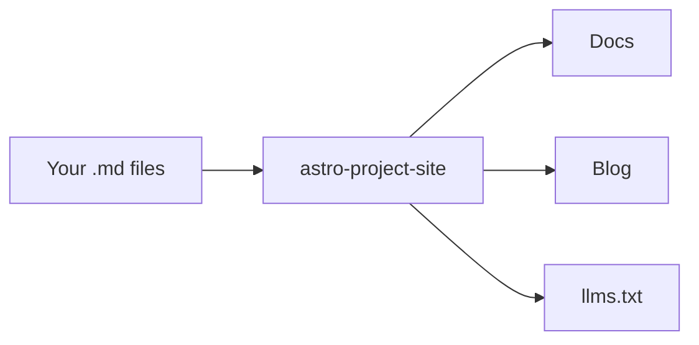
````


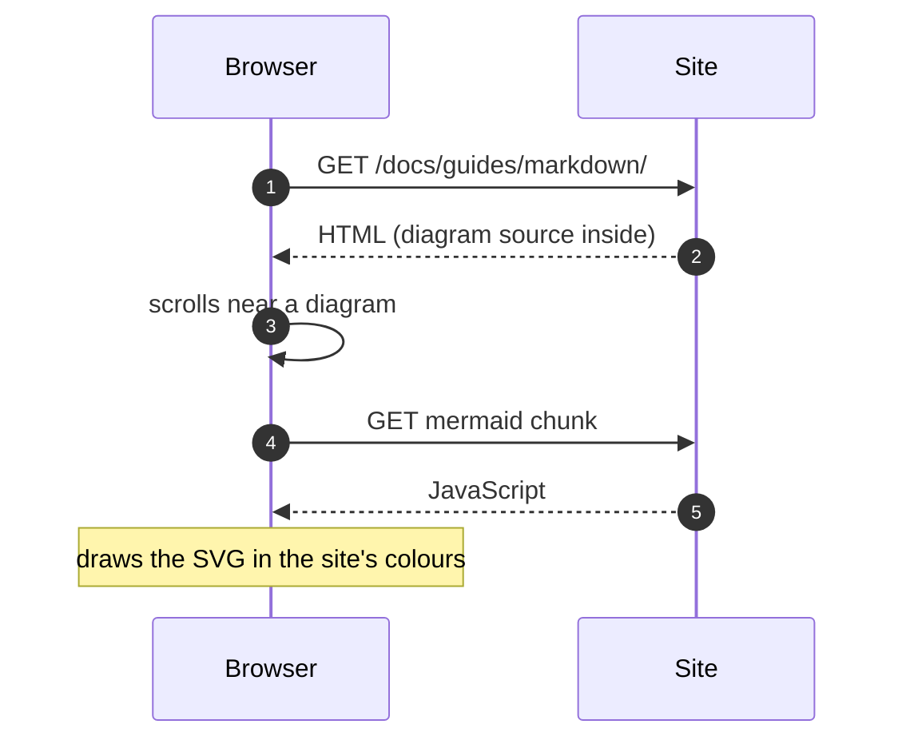

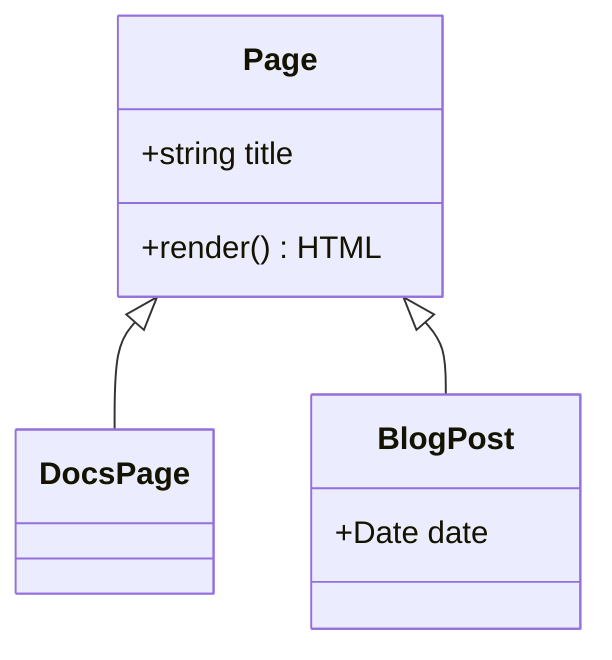

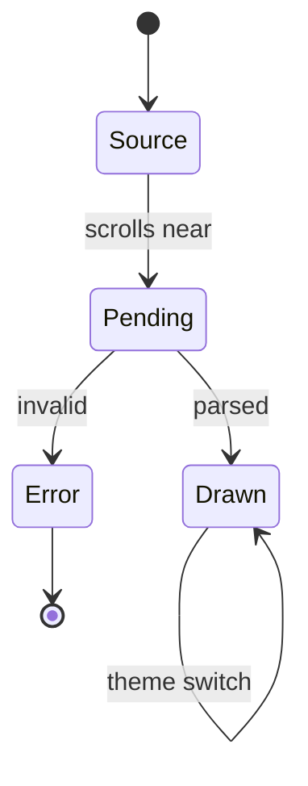

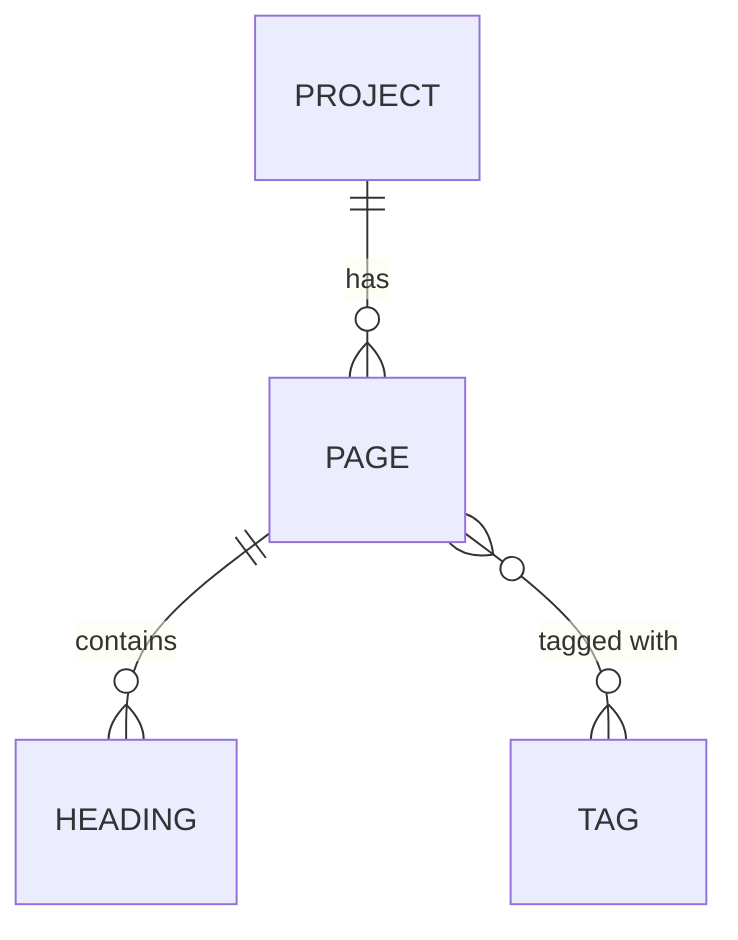

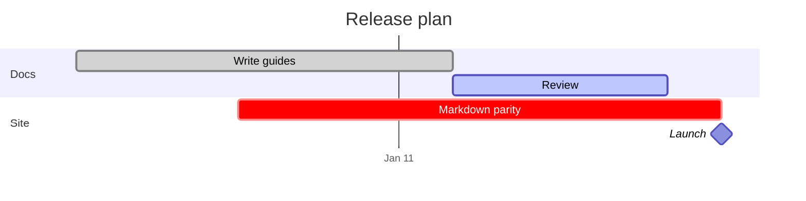

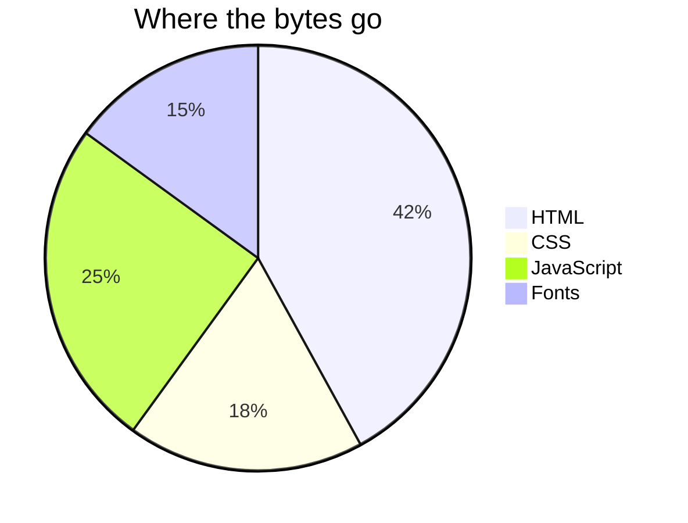

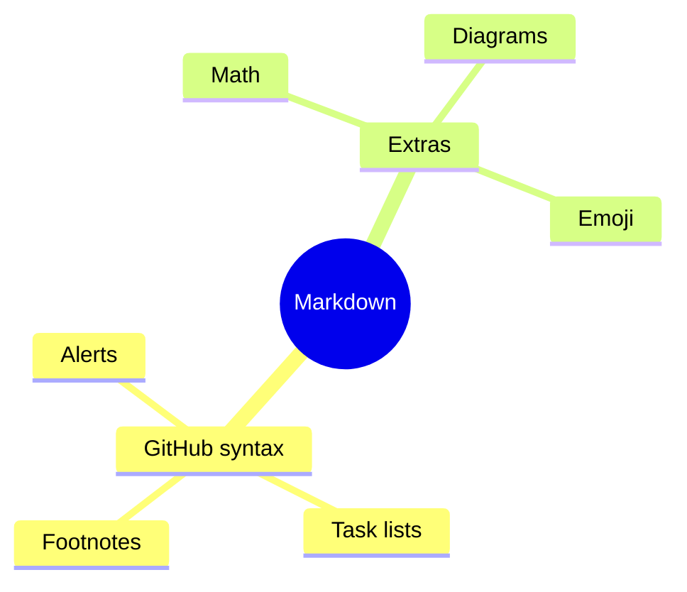

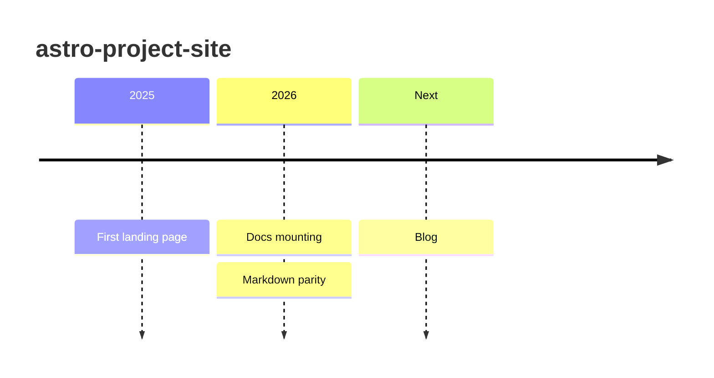

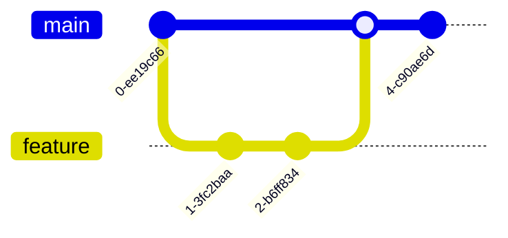

A wide diagram:

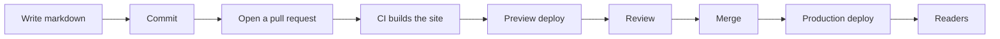

A diagram with a mistake shows its source and a note instead:

```mermaid
flowchart LR
  a --> 
  this is not mermaid
```

Diagrams use Mermaid's classic `dagre` layout. Its optional ELK engine is EPL-licensed and not bundled, so a
diagram that asks for `layout: elk` shows its source instead.

Give a diagram an accessible title and description with Mermaid's `accTitle:` and `accDescr:` lines; without them it
is announced by its type, and its source is available under "Diagram source".

## Raw HTML

HTML in markdown is passed through as written, as GitHub does for the tags it allows (`<details>`, `<kbd>`,
`<sub>`, `<sup>`, `<picture>`, `<br>`, alignment attributes, comments…). Unlike GitHub, nothing is stripped: the
markdown is your own repository's, so `<script>`, `<style>`, `<iframe>` and `style=""` work too. Do not render
markdown you do not trust with this site.

<p align="center">
  
</p>

## Options

Everything above is on by default. Each extra can be switched off with the `markdown` option:

```js
// astro.config.mjs
projectSite({
  // ...
  markdown: {
    alerts: true, // > [!NOTE] callouts
    emoji: true, // :tada: shortcodes
    math: true, // $…$, $$…$$, ```math (KaTeX)
    mermaid: true, // ```mermaid diagrams
    headingLinks: true, // anchor links on headings outside the docs (Starlight adds its own in the docs)
    codeWrapToggle: true, // "Wrap lines" button on code blocks that overflow
  },
});
```

Code block settings go to Starlight's [`expressiveCode`](https://starlight.astro.build/reference/configuration/#expressivecode)
option, `starlight: { expressiveCode: { … } }`: its `plugins` are added after the built-in ones, and its
`defaultProps` and `shiki.langAlias` win (`defaultProps: { showLineNumbers: true }` numbers every block).
